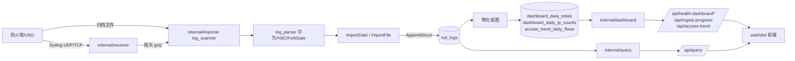

# fwlog V2 架构概览

面向开发方，描述**当前代码的真实调用链、分层与关键契约**。改代码前先读本文件与 [docs/README.md](../README.md)；设计决策看 [`../specs/`](../specs/)，实施计划看 [`../plans/`](../plans/)，历史修复与发布记录看 [`../reports/`](../reports/)。

## 1. 运行形态

- 单进程 Go 服务。入口 [cmd/fwlog/main.go](../../cmd/fwlog/main.go)：`config.LoadConfig()` → `server.NewApp(cfg)` → `app.Run(ctx)`，`SIGINT`/`SIGTERM` 触发优雅退出。
- 前端是 Vite 构建产物，编译期通过 `//go:embed web/dist` 内嵌进二进制（[internal/server/static.go](../../internal/server/static.go)）。`newStaticHandler()` 负责静态文件与 SPA 兜底，`/api` 前缀不走兜底。
- 部署形态：systemd 服务。完整包用仓库根 [fwlog.service](../../fwlog.service)（`Requires=fwlog-clickhouse.service`，内嵌运行时），升级包/外部数据库用 [packaging/systemd/fwlog.service](../../packaging/systemd/fwlog.service)（对接外部 `clickhouse-server.service`）；两者由 `packaging/build-server-packages.sh` 按 `include_clickhouse` 二选一。

## 2. 启动顺序

1. `NewApp`（[internal/server/server.go](../../internal/server/server.go)）：读 `ADMIN_PASSWORD` / `ADMIN_PASSWORD_FILE`（非 Windows 下强制 `0600`）→ 初始化日志与 `installedVersionInfo()` → 临时 JWT 管理器 → 默认设置 `defaultSettings(cfg)` → `NewImportCoordinator(cfg.Workers, cfg.Workers)`（`WORKERS` 同时限制并行导入的日期数与并发写入批次数）、receiver manager、archiver、排行/趋势缓存、威胁情报服务。
2. `App.Run`（[internal/server/router.go:94](../../internal/server/router.go#L94)）：
   - `Connect`：加载或生成 JWT 密钥文件 → `openClickHouseWithRetry`（30 次重试，间隔 2s）→ `EnsureTables` → `LoadSettings` → `applySavedSettingsLocked` → 记录 store → `reloadIPDataFromSettings` → `applyReceiverFromSettings`。
   - 启动 `autoScanScheduler`（按配置时间/间隔触发归档导入）与 `rsyslogArchiveScheduler`（按保留策略归档接收目录）。
   - 起 HTTP/HTTPS 监听：`cfg.TLSEnabled` 时用自签名证书（[internal/server/tls.go](../../internal/server/tls.go)）且 `MinVersion = TLS 1.2`；`ReadTimeout 30s`、`WriteTimeout 60s`、`IdleTimeout 120s`；退出时关停 receiver 并在 10s 内 `Shutdown`。

## 3. 包分层

| 包 | 职责 | 主要依赖 |
|---|---|---|
| `cmd/fwlog` | 进程入口与信号处理 | `config`、`server` |
| `internal/config` | 环境变量/默认值解析（端口、ClickHouse 地址、日志目录、TLS、worker 数等） | 无内部依赖 |
| `internal/model` | 跨层共享的领域类型（`NATLogRow`、`IngestStatus`、`DateIngestState` 等） | 无内部依赖 |
| `internal/security` | PBKDF2 口令哈希、JWT 会话、TOTP 与恢复码 | `model` |
| `internal/ip` | IP 归属判定：自定义映射、CIDR 别称、GeoIP 库、网段匹配 | `model` |
| `internal/storage/clickhouse` | 唯一 SQL 归属地：DDL、迁移、设置/日志来源/入库状态/威胁情报结果/nat_logs 读写、聚合与磁盘占用查询 | `model`、`query` 等 |
| `internal/importer` | 日志扫描、解析（华为 USG / H3C / FortiGate）、按日期导入、重试状态、自动扫描计划 | `model`、`ip`、`security`(可选) |
| `internal/receiver` | Syslog 接收（UDP/TCP，路由到来源）、按天 gzip 归档与保留策略 | `model` |
| `internal/query` | 查询请求校验、可见日期范围、游标分页、`BuildQuerySQL` | `model` |
| `internal/dashboard` | 概览/排行/入库进度/访问趋势的视图组装与缓存降级策略 | `model`、`query` |
| `internal/health` | 宿主机 CPU/内存/磁盘等系统指标采集 | 无内部依赖 |
| `internal/threatintel` | 四家平台适配器（微步/绿盟/奇安信/腾讯）、凭据 AES-256-GCM 加密、按需分析编排 | `model` |
| `internal/upgrade` | 升级状态机类型（`State`/`Status`） | 无内部依赖 |
| `internal/version` | 读取 `/opt/fwlog/VERSION` 与 `RUNTIME_VERSION` | 无内部依赖 |
| `internal/server` | App 装配、路由、中间件、认证、设置、导入/升级控制、静态资源 | 上述全部 |
| `internal/server/handlers` | HTTP handler 适配层（把 App 的服务方法暴露为 `http.Handler`） | `dashboard` 等 |
| `packaging` | 安装包构建脚本与断言测试（无生产导入者，由 `go test ./...` 覆盖） | 无 |
| `web` | React/TypeScript/Vite 前端（构建产物输出到 `internal/server/web/dist`） | — |

## 4. 数据流

- 接收：`receiver.Manager` 按来源路由 Syslog，写入 spool 文件；`Archiver` 把已结束的自然日压缩为可导入的归档。
- 导入：`ImportCoordinator` 限制并发来源与并发写入；`ImportDate`/`ImportFile` 逐文件解析并写状态（`ingest_dates` / `ingest_files`），成功后按来源+日期清理对应分区。
- 读取：常态概览只查预聚合表；`/api/query` 按可见日期范围 + 游标分页查 `nat_logs`。

## 5. ClickHouse 表

| 表 | 引擎 | 说明 |
|---|---|---|
| `nat_logs` | `MergeTree` | NAT 五元组原始日志，双栈 IP 列，按 `log_date` + 来源分区（DDL 见 [internal/storage/clickhouse/store.go](../../internal/storage/clickhouse/store.go)，IPv4→IPv6 迁移见 [migrations.go](../../internal/storage/clickhouse/migrations.go)） |
| `dashboard_daily_totals` | `SummingMergeTree` | 按日总量预聚合 |
| `dashboard_daily_ip_counts` | `SummingMergeTree` | 按日来源/目的 IP 与目的网段计数 |
| `access_trend_daily_flows` | `AggregatingMergeTree` | 访问趋势按日聚合 |
| `ingest_dates` / `ingest_files` | `ReplacingMergeTree(updated_at)` | 日期/文件级入库状态与重试计数 |
| `log_sources` / `app_settings` | `ReplacingMergeTree(updated_at)` | 日志来源与设置持久化 |
| `threat_intelligence_results` | `ReplacingMergeTree(analyzed_at)` | 平台 + IP 的最新成功分析结果 |

物化视图：`dashboard_daily_totals_mv`、`dashboard_daily_src_ip_mv`、`dashboard_daily_dst_ip_mv`、`dashboard_daily_dst_subnet_mv`、`access_trend_daily_flows_mv`（[dashboard_aggregates.go](../../internal/storage/clickhouse/dashboard_aggregates.go)）。

## 6. HTTP 契约

全部路由集中在 `App.Router()`（[internal/server/router.go:10](../../internal/server/router.go#L10)），分四类：

| 类别 | 路径 |
|---|---|
| 公开 | `/api/setup`、`/api/setup/status`、`/api/login`、`/api/session` |
| 需会话（`requireAuth`） | `/api/query`、`/api/health-dashboard`、`/api/health-dashboard/summary`、`/api/health-dashboard/rankings`、`/api/ingest-progress`、`/api/access-trend`、`/api/settings`、`/api/password`、`/api/ip-data/reload`、`/api/receiver/status`、`/api/sync`、`/api/rebuild`、`/api/upgrade/{check,status,run,upload}`、`/api/version`、`/api/logout`、`/api/mfa/*`、威胁情报 provider 路由 |
| MCP | `/api/mcp`、`/api/mcp/token`：Bearer 认证 + `mcp_enabled` 开关 + `requireMCPEnabled` |
| 占位 | `/api/export` 固定返回 501 `not_implemented` |

约定：`/api/query` 额外受 `external_api_enabled` 开关约束；新增接口必须注册到 `Router()` 并补 `routes_test.go` 的未认证拒绝用例；handler 层不得直接拼 ClickHouse SQL。

## 7. 前端

- 入口 [web/src/main.tsx](../../web/src/main.tsx)：会话/初始化状态检查 → 按 `?preview=upgrade|access|login` 渲染独立预览页 → 否则渲染 `AppLayout` + 页面。
- 页面位于 `web/src/pages/`（概览、日志查询、日志接收、系统维护、增量进度、升级预览、初始化、登录）。
- 构建：`cd web && npm run build`（`tsc -b && vite build`），输出目录 `internal/server/web/dist`（被 `.gitignore` 忽略，但被 `go:embed` 引用，改动后端静态资源前需先构建）。
- 测试：`cd web && npm test`（`node --test "tests/*.test.ts"`），覆盖文案口径、展示逻辑与源码契约断言。

## 8. 升级与打包

- 版本来源：编译期 `internal/server/upgrade_service.go` 的 `appVersion = "dev"`（正式包由 `.github/workflows/release-build.yml` 通过 ldflags 注入）；安装期由 `packaging/build-server-packages.sh` 写 `/opt/fwlog/VERSION` 与 `/opt/fwlog/RUNTIME_VERSION`，运行时由 `internal/version` 读取。
- 包类型：full（含 ClickHouse 运行时与回填脚本）与 upgrade（只含应用与安装脚本，必须不含 `RUNTIME_VERSION` 和内嵌 ClickHouse，由 CI smoke test 断言）。
- 在线升级：`/api/upgrade/check` 读取 GitHub Release 的 `latest.json`（`app_version` / `runtime_version`）与 `checksums.txt`，按发行版选择 deb/rpm，校验和失败即拒绝。
- 运维脚本：`scripts/backfill-dashboard-aggregates.sh`、`scripts/backfill-access-trend-aggregates.sh` 由安装脚本执行；`scripts/build-query-extension.sh` 生成 Chrome 查询插件分发包 `web/public/downloads/fwlog-query-extension.zip`。

## 9. 改代码时的硬约束

详见 [AGENTS.md](../../AGENTS.md) 第 3、8、9、10 节。与本文件直接相关的几条：

- SQL 只在 `internal/storage/clickhouse` 内维护，遵循 `ReplacingMergeTree` 版本列约定，迁移不得原地改版本列。
- 概览常态查询走预聚合表，冷排行/回填保持单 worker，避免占满多核。
- 系统设置键统一经 `/api/settings` 校验；`threat_intelligence.*` 例外，只走专用接口。
- 前端与后端共用同一份中文文案口径，改动涉及文案时要同步 `web/tests/` 中的 wording 断言。
- 行为/可执行能力/目录结构变更需要按 [AGENTS.md](../../AGENTS.md) 第 6 节在 `docs/reports/` 追加修复报告。
